  

<h2 align="left"> Hello there! I'm Chandan Garg, a Full Stack Web Developer and Node.js enthusiast.</h2>

I build AI-native tools that turn messy inputs (a spoken sentence, a stack trace, an open question) into something you can act on. Below are three of them, with their pipelines running live.

  
  
  
  
  
  
  
  
  
  
  
  
  
  
  
  
  
  
  
  
  
  
  
  
  
  
  

---

##  Featured projects · live workflows

### 🎙 [VoiceGraph](https://github.com/Chandan11232/voicegraph) — *say the system, shape it by hand*

A voice-first architecture whiteboard. Describe a system out loud and it becomes an editable diagram. Refine it by voice or by hand, get an AI architecture review that flags single points of failure, and export to PNG, SVG, Mermaid or a generated README section.

&nbsp;→&nbsp; **[Live demo](https://voicegraph-mocha.vercel.app)** · **[Code](https://github.com/Chandan11232/voicegraph)**

---

###  [GraphSleuth](https://github.com/Chandan11232/GraphSleuth) — *from bug report to verified fix*

A bug-investigation agent that reasons over a FalkorDB graph of your codebase. Give it a bug report or stack trace and it traces call paths to the likely root cause, shows the Cypher behind every step, drafts a patch, tests it in a sandbox before and after, and prepares a PR with suggested reviewers, waiting for a human to approve. Confirmed root causes are remembered for next time. Built for Graph Hacks 2026.

&nbsp;→&nbsp; **[Live demo](https://codebase-detector.vercel.app)** · **[Code](https://github.com/Chandan11232/GraphSleuth)**

---

###  [ResearchMind](https://github.com/Chandan11232/research-mind) — *research that iterates until it's sure*

An iterative AI research app. A LangGraph workflow plans, searches the web with Tavily, analyzes what it found with Llama 3.3 on Groq, and loops back with a refined query until it has enough evidence to write the report, all driven from a dark terminal-style Next.js UI.

&nbsp;→&nbsp; **[Live demo](https://research-mind.vercel.app)** · **[Code](https://github.com/Chandan11232/research-mind)**

---

##  Let's connect

  
  
  

 

  

