 

I build tools that turn unstructured input (a spoken sentence, a stack trace, an open question) into something structured you can act on. Mostly Node.js and TypeScript on the product side, Python where the agents live.

 

### Selected work

**[VoiceGraph](https://github.com/Chandan11232/voicegraph)** — A voice-first architecture whiteboard. Describe a system out loud and it becomes an editable diagram you can refine by voice or by hand, review for weak spots, and export as PNG, SVG or Mermaid.
 React Flow · Vite · elkjs · Groq · Vercel &nbsp;·&nbsp; [Live ↗](https://voicegraph-mocha.vercel.app) &nbsp;·&nbsp; [Source ↗](https://github.com/Chandan11232/voicegraph)

 

**[GraphSleuth](https://github.com/Chandan11232/GraphSleuth)** — A bug-investigation agent that reasons over a graph of your codebase. From a stack trace it traces call paths to the root cause, shows the Cypher behind each step, verifies a patch in a sandbox, and drafts a PR that waits for human approval. Built for Graph Hacks 2026.
 Python · FastAPI · FalkorDB · tree-sitter · MCP · React Flow &nbsp;·&nbsp; [Live ↗](https://codebase-detector.vercel.app) &nbsp;·&nbsp; [Source ↗](https://github.com/Chandan11232/GraphSleuth)

 

**[ResearchMind](https://github.com/Chandan11232/research-mind)** — An iterative research agent. A LangGraph loop plans, searches, analyzes, and refines its query until the evidence is sufficient, then writes a cited report, all driven from a terminal-style interface.
 LangGraph · FastAPI · Groq (Llama 3.3) · Tavily · Next.js &nbsp;·&nbsp; [Live ↗](https://research-mind.vercel.app) &nbsp;·&nbsp; [Source ↗](https://github.com/Chandan11232/research-mind)

 

### Stack

| | |
|---|---|
| **Languages** | JavaScript, TypeScript, Python, Java |
| **Frontend** | React, Next.js, React Flow, HTML, CSS |
| **Backend** | Node.js, Express, FastAPI |
| **AI / agents** | LangGraph, Groq, Ollama, Tavily, MCP |
| **Data** | FalkorDB, MongoDB |
| **Ship** | Vercel, Render, Docker, GitHub Actions |

### Recent activity

<!--START_SECTION:activity-->
<!--END_SECTION:activity-->

### Contact

[cgarg2461@gmail.com](mailto:cgarg2461@gmail.com) &nbsp;·&nbsp; [LinkedIn](https://www.linkedin.com/in/chandan-garg-701b81420/) &nbsp;·&nbsp; [GitHub](https://github.com/Chandan11232)
